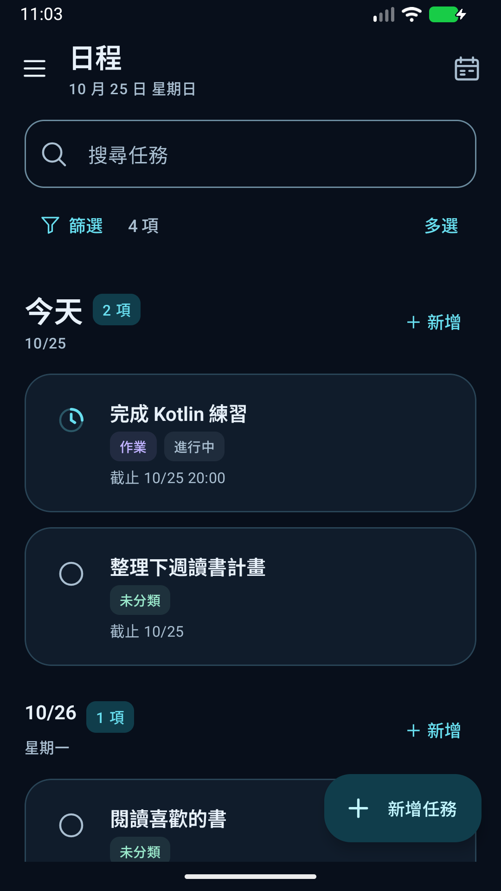
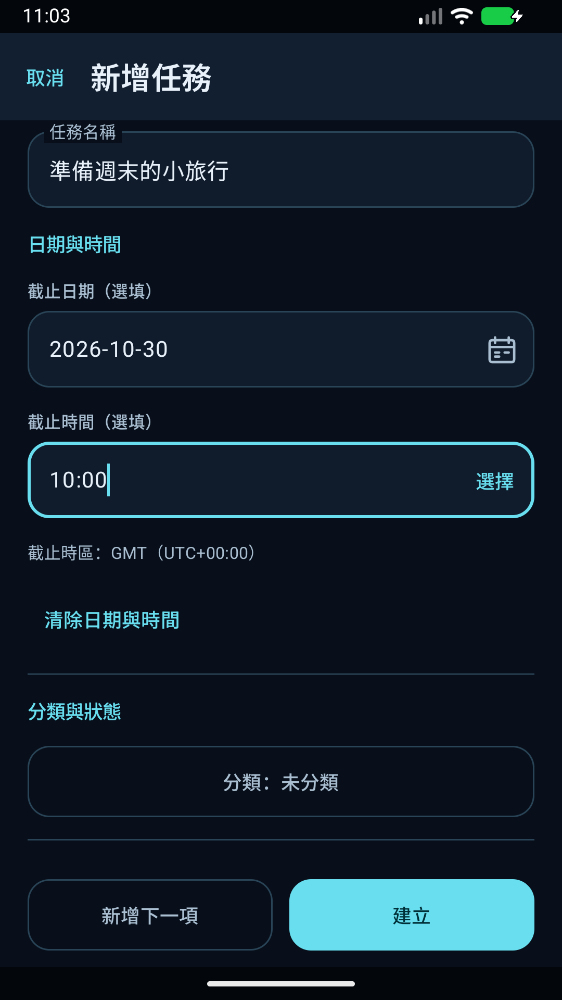
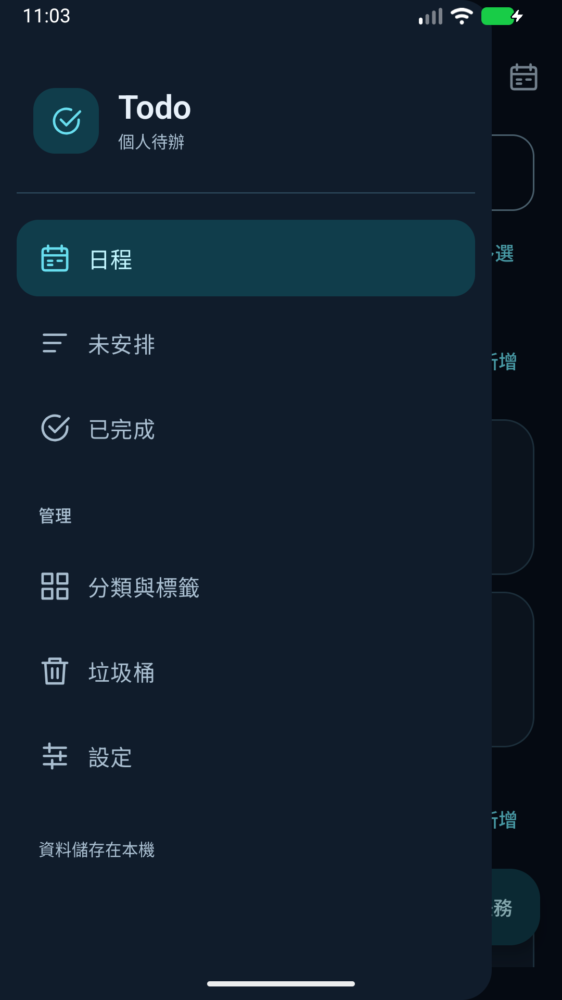

# Todo

語言 / 语言 / Languages：<a href="README.md">繁體中文</a> · <a href="README.zh-CN.md">简体中文</a> · <strong>English</strong>

A local Android task manager with a fixed dark theme, Traditional Chinese, Simplified Chinese and English. Organize recurring tasks, multiple reminders, categories and tags, with JSON backup and no account required.

[Download APK](https://github.com/chimafok/Todo-App/releases/latest) · [User guide](docs/en/USER-GUIDE.md) · [Install and update](docs/en/INSTALL.md) · [Report an issue](https://github.com/chimafok/Todo-App/issues/new/choose)

- Android 8.0 (API 26) or later; choose a supported language or follow the system.
- Built with Kotlin, Jetpack Compose, Material 3 and Room.
- An actively developed personal project. Official signing does not mean every phone or background scenario has been validated; see [known limitations](docs/en/KNOWN-ISSUES.md).

## Interface language

Since 1.4.0, open **Settings → App language** to choose Traditional Chinese, Simplified Chinese, English or System default. System default uses the first supported language in the system preference list, falling back to English. Custom content, deadline time zones and reminder instants stay unchanged. Backup format 6 includes the language preference and can import formats 1–5. See the [translation guide](docs/en/TRANSLATING.md).

## Features

- **Agenda and Unscheduled:** tasks grouped by date, full result counts and compact empty-state hints.
- **Tasks and drafts:** notes, images, dates, times, a category and multiple tags; Study has three progress states and optional start dates/times. Keep a draft when leaving the new-task form.
- **Assignment progress:** Not started, In progress, Done, not submitted, and Completed. Done, not submitted remains pending.
- **Recurring tasks:** daily, weekly, selected weekdays, monthly or every N days, with future-generation controls and independent records.
- **Reminders:** fixed dates/times or minutes, hours or days before a deadline; multiple reminders with captured input time zones.
- **Search and selection:** search titles, notes, categories and tags; filters and long-press selection. Restore or permanently delete multiple Trash items.
- **Categories and tags:** long-press drag ordering and a separate bulk-delete mode. Move tasks before deleting a category; deleting a tag preserves tasks.
- **Local backup:** JSON through the system document picker, including note images, Trash, category/tag order and general settings. Preview restores and resolve conflicts first.

## Screenshots

These Traditional Chinese examples use synthetic data in an isolated test environment. Some labels may differ from the latest version.

  
  
  

## Installation

Download an APK from [GitHub Releases](https://github.com/chimafok/Todo-App/releases/latest), then allow installation from that source when Android asks. The automatically generated `Source code.zip` is source code, not an Android installer.

Later official versions can update an existing official installation while retaining data. Export important data first. See [installation and updates](docs/en/INSTALL.md).

Reminders need notification permission. Android manages exact-alarm access separately. Battery restrictions, force-stop and other background policies may affect delivery; see [reminders](docs/en/USER-GUIDE.md#reminders).

## Development

Open this folder in Android Studio. See the [development guide](docs/en/DEVELOPMENT.md) for requirements and commands, and the [product specification](docs/en/PRD.md) for behavior.

This is the main development repository. `main` is the checked release baseline; `dev` integrates work from short-lived branches such as `codex/*`. All branches are public. Outside contributors can submit fork pull requests; merging requires maintainer permissions. CI or a merge does not publish an APK: Releases is the source for installable versions. App changes are delivered as development-signed test APKs first. Formal signing, the corresponding `main` merge and publication require explicit maintainer approval. See [contributing](docs/en/CONTRIBUTING.md#branches-and-merges) for the documentation-only route, permissions and release approval.

## Documentation and support

[Documentation index](docs/en/README.md) · [Privacy](docs/en/PRIVACY.md) · [Security](docs/en/SECURITY.md) · [Contributing](docs/en/CONTRIBUTING.md) · [Changelog](docs/en/CHANGELOG.md) · [Verification](docs/en/TESTING.md)

Include the app and Android versions, reproduction steps and redacted screenshots in reports. Do not attach real task backups, passwords or keys.

## License

Copyright © 2026 chimafok. Project-owned code and documentation use the [MIT License](LICENSE). Dependencies retain their own licenses; see [third-party notices](docs/en/THIRD-PARTY-NOTICES.md).
