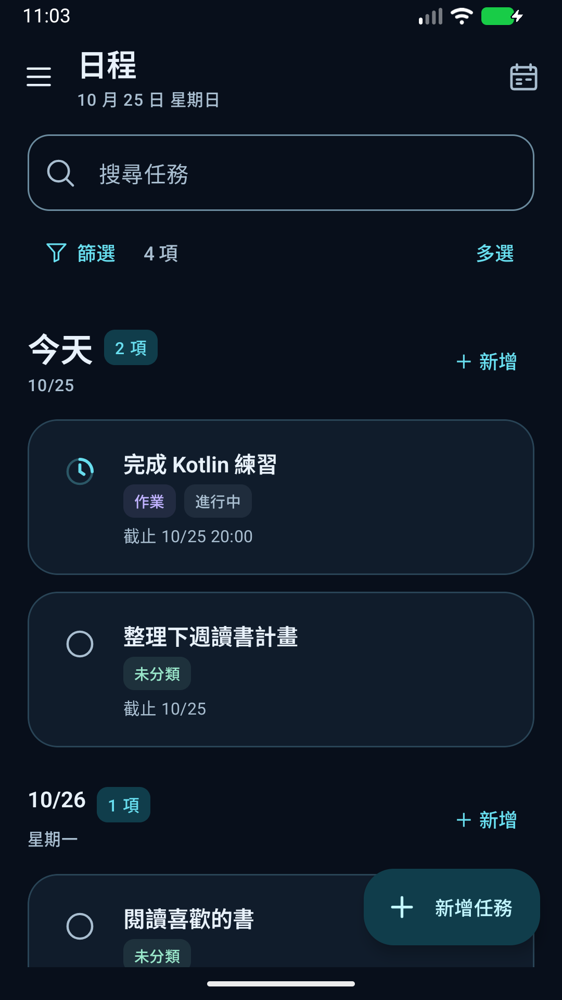
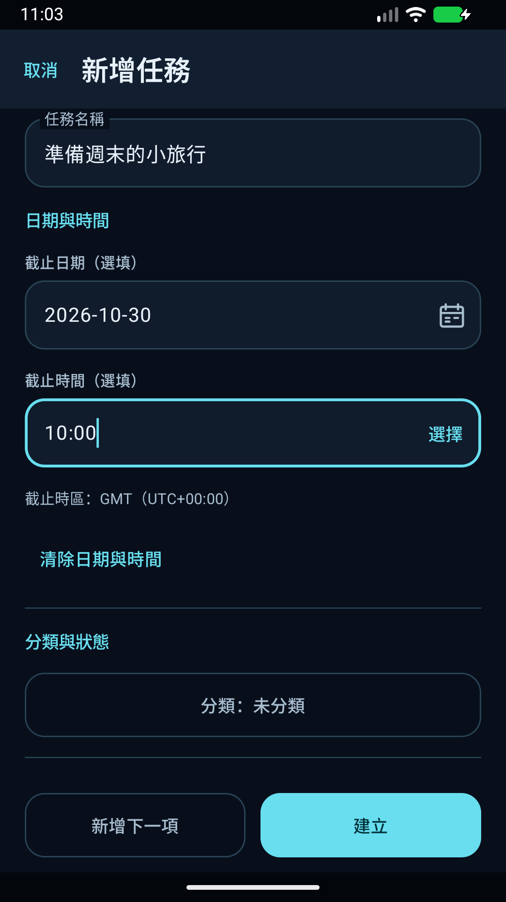
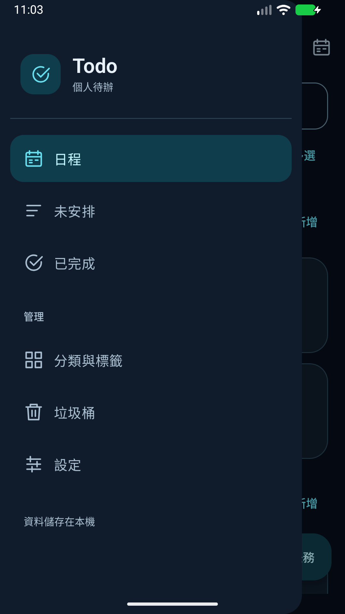

# Todo

繁體中文、固定深色介面的 Android 待辦 App。任務儲存在本機，支援重複任務、多個提醒、分類標籤與 JSON 備份，不需要帳號。

[下載 APK](https://github.com/chimafok/Todo-App/releases) · [使用說明](docs/USER-GUIDE.md) · [安裝與更新](docs/INSTALL.md) · [回報問題](https://github.com/chimafok/Todo-App/issues/new/choose)

- Android 8.0（API 26）以上，介面以繁體中文提供。
- Kotlin、Jetpack Compose、Material 3 與 Room。
- 目前為持續開發中的個人專案；正式發布金鑰不代表所有手機與背景情境均已完成驗收，請閱讀[已知限制](docs/KNOWN-ISSUES.md)。

## 功能

- **日程與未安排**：按日期整理待辦，顯示完整項數；空白區塊使用簡短提示。
- **任務與草稿**：名稱、備註、日期時間、分類與多個標籤；離開新增表單時可選擇保留草稿。
- **作業進度**：未開始、進行中、完成未繳交及已繳交；完成未繳交仍保留為待辦。
- **重複任務**：每日、每週、指定星期、每月與每隔 N 天，支援停止未來生成與獨立歷史紀錄。
- **提醒**：固定日期時間或截止前的分鐘／小時／天，可為同一任務設定多個提醒，記錄輸入時區。
- **搜尋與多選**：搜尋名稱、備註、分類與標籤，支援篩選及長按多選；垃圾桶可批次復原或永久刪除。
- **本機備份**：透過系統檔案選擇器匯出 JSON，還原時先預覽並處理衝突。

## 畫面

以下畫面使用隔離測試環境與虛構任務。

  
  
  

## 安裝

到 [GitHub Releases](https://github.com/chimafok/Todo-App/releases) 下載 APK，依 Android 指示允許該下載來源安裝。`Source code.zip` 是原始碼，不是手機安裝檔。

後續正式版可直接安裝更新，保留既有資料；更新前建議匯出重要內容。操作步驟見[安裝與更新](docs/INSTALL.md)。

提醒需要通知權限；精確提醒能力另由 Android 管理。手機省電、強制停止或背景限制可能影響送達，詳見[提醒說明](docs/USER-GUIDE.md#提醒)。

## 開發

使用 Android Studio 開啟本資料夾。所需版本、建置及測試步驟見[開發指南](docs/DEVELOPMENT.md)，產品行為見[產品規格](docs/PRD.md)。

本倉庫是主要開發位置：`main` 保留經檢查的發布基準，`dev` 用於整合，獨立工作使用短期 `codex/*` 分支；測試後以 Pull Request 合併。所有分支均公開，外部貢獻可由 fork 提交 PR；合併由具有權限的維護者處理。CI 通過或合併不會自動發布 APK，手機版本以 Releases 為準。一般開發、文件小修及權限說明見[分支與合併流程](CONTRIBUTING.md#分支與合併)。

## 文件與回報

[隱私說明](PRIVACY.md) · [安全問題](SECURITY.md) · [貢獻指南](CONTRIBUTING.md) · [版本紀錄](CHANGELOG.md) · [驗證說明](docs/TESTING.md)

問題回報請附 App／Android 版本、重現步驟和遮蔽個人內容後的畫面，不要附真實任務備份、密碼或金鑰。

## 授權

Copyright © 2026 chimafok。專案自有程式碼與文件採用 [MIT License](LICENSE)；第三方依賴沿用各自授權，見[第三方聲明](THIRD-PARTY-NOTICES.md)。
