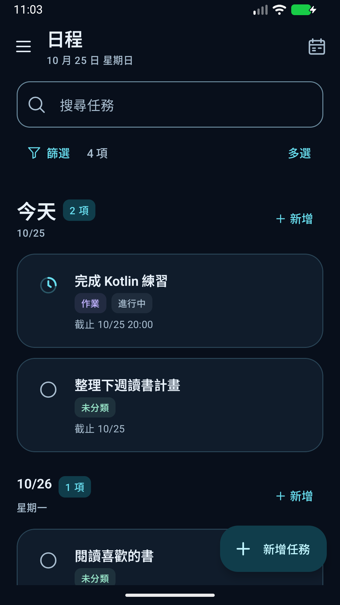
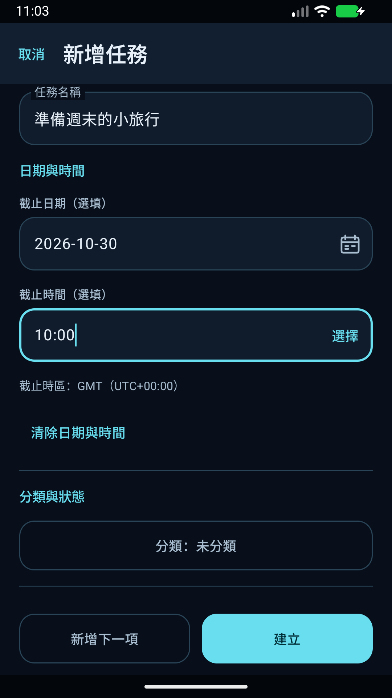
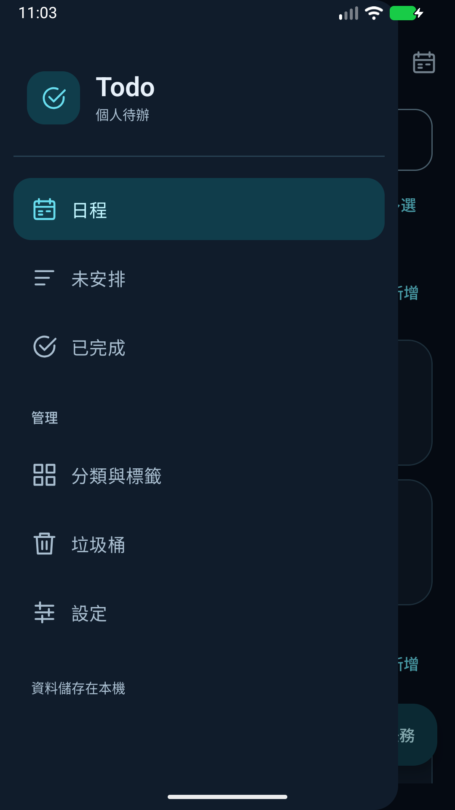

# Todo

語言 / 语言 / Languages：<a href="README.md">繁體中文</a> · <strong>简体中文</strong> · <a href="README.en.md">English</a>

支持繁体中文、简体中文与英文的固定深色 Android 待办 App。任务存储在本机，支持重复任务、多个提醒、分类标签与 JSON 备份，不需要账号。

[下载 APK](https://github.com/chimafok/Todo-App/releases/latest) · [使用说明](docs/zh-CN/USER-GUIDE.md) · [安装与更新](docs/zh-CN/INSTALL.md) · [反馈问题](https://github.com/chimafok/Todo-App/issues/new/choose)

- Android 8.0（API 26）以上，可选繁中、简中、英文或跟随系统。
- Kotlin、Jetpack Compose、Material 3 与 Room。
- 目前为持续开发中的个人专案；正式发布金钥不代表所有手机与背景情境均已完成验收，请阅读[已知限制](docs/zh-CN/KNOWN-ISSUES.md)。

## 界面语言

1.4.0 起提供繁体中文、简体中文、English 及「跟随系统」，入口为「设定 → 介面语言」；不支持的系统语言使用英文。自定义内容与截止／提醒时区保持原样。语言偏好随格式 6 备份保存，并可读取旧格式 1–5。翻译协作见 [TRANSLATING](docs/zh-CN/TRANSLATING.md)。

## 功能

- **日程与未安排**：按日期整理待办，显示完整项数；空白区块使用简短提示。
- **任务与草稿**：名称、备注与图片附件、日期时间、分类与多个标签；学习分类提供未开始／进行中／完成三态，并可另填开始日期／时间，离开新增表单时可选择保留草稿。
- **作业进度**：未开始、进行中、完成未缴交及完成；完成未缴交仍保留为待办。
- **重复任务**：每日、每周、指定星期、每月与每隔 N 天，支持停止未来生成与独立历史记录。
- **提醒**：固定日期时间或截止前的分钟／小时／天，可为同一任务设置多个提醒，记录输入时区。
- **搜索与多选**：搜索名称、备注、分类与标签，支持筛选及长按多选；垃圾桶可批次恢复或永久删除。
- **分类与标签管理**：长按拖拽排序，另设批量删除模式；删除分类先搬移任务，删标签保留任务。
- **本机备份**：透过系统文件选择器导出 JSON，包含备注图片、垃圾桶、分类／标签排序与一般设置；还原时先预览并处理冲突。

## 画面

以下画面使用隔离测试环境与虚构任务；为繁中操作示意，个别文字可能与最新版本略有不同。

  
  
  

## 安装

到 [GitHub Releases](https://github.com/chimafok/Todo-App/releases) 下载 APK，依 Android 指示允许该下载来源安装。`Source code.zip` 是源代码，不是手机安装档。

后续正式版可直接安装更新，保留既有数据；更新前建议导出重要内容。操作步骤见[安装与更新](docs/zh-CN/INSTALL.md)。

提醒需要通知权限；精确提醒能力另由 Android 管理。手机省电、强制停止或背景限制可能影响送达，详见[提醒说明](docs/zh-CN/USER-GUIDE.md#reminders)。

## 开发

使用 Android Studio 开启本文件夹。所需版本、建置及测试步骤见[开发指南](docs/zh-CN/DEVELOPMENT.md)，产品行为见[产品规格](docs/zh-CN/PRD.md)。

本仓库是主要开发位置：`main` 保留经检查的发布基准，`dev` 用于整合，独立工作使用短期 `codex/*` 分支；测试后以 Pull Request 合并。所有分支均公开，外部贡献可由 fork 提交 PR；合并由具有权限的维护者处理。CI 通过或合并不会自动发布 APK，手机版本以 Releases 为准。App 改动会先提供开发签章的测试 APK，待维护者明确同意后，才正式签署、合并 `main` 并发布。一般开发、文件小修、权限与确认流程见[贡献指南](docs/zh-CN/CONTRIBUTING.md#branches-and-merges)。

## 文件与反馈

[文件索引](docs/zh-CN/README.md) · [隐私说明](docs/zh-CN/PRIVACY.md) · [安全问题](docs/zh-CN/SECURITY.md) · [贡献指南](docs/zh-CN/CONTRIBUTING.md) · [版本记录](docs/zh-CN/CHANGELOG.md) · [验证说明](docs/zh-CN/TESTING.md)

问题反馈请附 App／Android 版本、重现步骤和遮蔽个人内容后的画面，不要附真实任务备份、密码或金钥。

## 授权

Copyright ? 2026 chimafok。专案自有代码与文件采用 [MIT License](LICENSE)；第三方依赖沿用各自授权，见[第三方声明](docs/zh-CN/THIRD-PARTY-NOTICES.md)。
